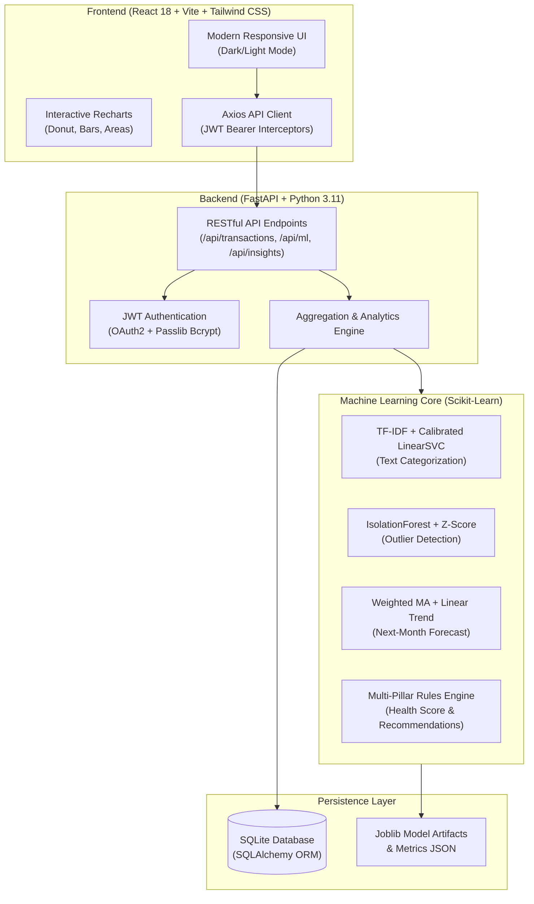

# FinSight AI — AI-Powered Personal Finance Management System

> **College "AI for Finance" Capstone Assignment**  
> Complete, production-ready, local-first personal finance platform with supervised machine learning, anomaly isolation, financial forecasting, and intelligent budgeting.

---

## 🌟 Key Highlights

- **100% Local AI** — Runs completely offline on local compute with zero paid API keys required.
- **Auto-Categorization** — High-accuracy TF-IDF (word + char n-grams) + Calibrated LinearSVC classifier trained on 3,600+ realistic noisy Indian bank statements with active human-in-the-loop feedback retraining.
- **Multivariate Anomaly Detection** — IsolationForest combined with robust per-category z-scores flagging spending spikes with plain-English rationales.
- **Predictive Cash Flow Forecasting** — Weighted moving averages and linear trend regression with 90% confidence bands.
- **Financial Health Score (0-100)** — Transparent multi-pillar score across savings rate, budget adherence, debt/EMI burden, volatility, and emergency buffer.
- **Interactive What-If Scenario Simulator** — Real-time sliders simulating category spending cuts and instant financial health score impact.
- **Full Indian Localization** — Native Indian Rupee (`₹`) support by default, with realistic merchant entities (Swiggy, Zomato, BigBasket, DMart, BESCOM, HDFC EMI, Zerodha, etc.).

---

## 🚀 Quick Start Guide

### ⚡ 1-Click Launch (Windows)
Double-click `run.bat` or run `.\run.ps1` in PowerShell from the project root. This automatically:
1. Launches the backend FastAPI server (`http://localhost:8000`)
2. Launches the frontend Vite server (`http://localhost:5173`)
3. Opens the web app directly in your default browser

---

### Prerequisites
- **Python 3.11+**
- **Node.js 18+ & npm**

---

### Manual Launch (Step-by-Step)

---

### Step 1: Backend Setup & Seeding

```bash
# 1. Navigate to backend directory
cd backend

# 2. Install Python dependencies
pip install -r requirements.txt

# 3. Master seed script (Generates synthetic dataset, trains ML model, creates DB, seeds 6 months of demo data)
python -m scripts.seed_all

# 4. Start the FastAPI server
uvicorn app.main:app --reload --port 8000
```

Backend API will be running at `http://localhost:8000`  
Interactive Swagger API docs at `http://localhost:8000/docs`

---

### Step 2: Frontend Setup & Launch

```bash
# 1. In a new terminal, navigate to frontend directory
cd frontend

# 2. Install npm dependencies
npm install

# 3. Start Vite development server
npm run dev
```

Frontend application will open at `http://localhost:5173`

---

## 🔑 Demo Account Credentials

The application is pre-seeded with 6 months of realistic transaction history, planted anomalies, active budgets, and savings targets:

| Field | Value |
|---|---|
| **Email** | `demo@finsight.ai` |
| **Password** | `Demo@123` |
| **Role** | Seeded Demo User |

---

## 🛠️ Tech Stack & Architecture



---

## 📂 Project Structure

```
finsight-ai/
├── backend/
│   ├── app/
│   │   ├── main.py              # FastAPI application & CORS configuration
│   │   ├── config.py            # Environment-based Pydantic BaseSettings
│   │   ├── database.py          # SQLAlchemy SQLite session factory
│   │   ├── models.py            # User, Transaction, Budget, Goal ORM models
│   │   ├── schemas.py           # Pydantic v2 validation models
│   │   ├── auth.py              # JWT token utilities & auth dependencies
│   │   ├── routers/             # API routes: auth, transactions, ml, analytics, budgets, goals, insights
│   │   ├── services/            # Analytics aggregations & insights business logic
│   │   └── ml/                  # ML models: categorizer, anomaly detector, forecaster, recommendations
│   ├── ml_artifacts/            # Saved model (.joblib), training data, and metrics.json
│   ├── scripts/
│   │   ├── generate_sample_data.py # Generates 3,600+ synthetic samples & realistic demo statements
│   │   ├── train_model.py       # Standalone training script
│   │   └── seed_all.py          # One-command full environment & DB setup
│   ├── tests/                   # Pytest test suite (100% passing)
│   └── requirements.txt
├── frontend/
│   ├── src/
│   │   ├── api/client.js        # Axios instance with auth interceptors
│   │   ├── context/             # AuthContext & ThemeContext (dark/light)
│   │   ├── components/          # Sidebar, Navbar, Layout, AddTransactionModal, CSVImportModal
│   │   ├── pages/               # Dashboard, Transactions, Insights, Budgets, HowItWorks, Settings, Login, Register
│   │   ├── App.jsx              # Protected route mapping
│   │   └── main.jsx
│   ├── package.json
│   ├── tailwind.config.js
│   └── vite.config.js
├── sample_data/
│   └── transactions_sample.csv  # 6-month exported demo transaction ledger
├── docs/
│   ├── PROJECT_REPORT.md        # Comprehensive 5-page academic project report
│   ├── DEMO_SCRIPT.md           # 5-minute step-by-step viva presentation script
│   └── screenshots/             # Visual walkthrough captures of all pages
└── README.md
```

---

## 🧪 Automated Testing

All backend unit and integration tests can be verified with:

```bash
cd backend
python -m pytest
```

Test coverage includes:
- JWT registration, duplicate handling, login, and authorization checks
- Transaction CRUD, search, category filtering, and user feedback tracking
- CSV statement parsing and row-level error validation
- Text categorizer test accuracy (>90% threshold requirement)
- IsolationForest anomaly detection on planted spending spikes
- Weighted MA trend forecasting with confidence intervals
- Multi-pillar Financial Health score calculation and What-If simulator

---

## 📄 License
This project is built for educational and academic evaluation purposes.

