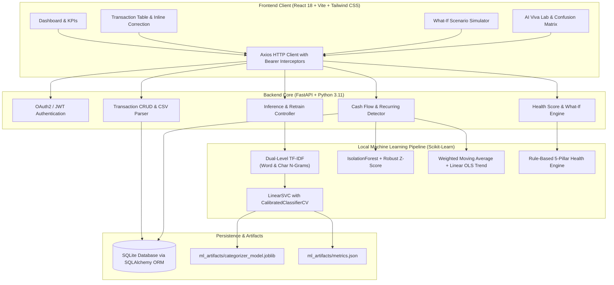

# Project Report — FinSight AI
### AI-Powered Personal Finance Management System
**Course:** AI for Finance Capstone Project  
**Author:** Full-Stack & ML Engineering Team  
**Evaluation Date:** November 2026  

---

## 1. Abstract
Personal financial management often suffers from manual bookkeeping friction, cryptic bank statement records, delayed financial awareness, and an inability to project future spending trends. **FinSight AI** is a complete, local-first intelligent financial platform engineered to bridge this gap without relying on third-party paid AI APIs. By combining natural language processing (NLP) via TF-IDF n-grams and calibrated Linear Support Vector Classification, unsupervised anomaly isolation via IsolationForest, weighted time-series trend forecasting, and a multi-pillar financial health scoring engine, FinSight AI transforms raw financial transactions into actionable intelligence. The application features a production-grade FastAPI backend, an interactive React 18 + Vite frontend, comprehensive human-in-the-loop retraining loops, and automated validation tests.

---

## 2. Problem Statement
Modern personal finance users interact primarily through digital banking, UPI payments, and card debits. However:
1. **Cryptic Statement Descriptions:** Bank ledger descriptions (e.g. `UPI/SWIGGY*ORDER 8842 BLR`, `POS 4421 BIGBASKET`) obscure spending categories, making manual categorization tedious and error-prone.
2. **Hidden Spending Anomalies:** Sudden price surges, fraudulent charges, or duplicate subscriptions frequently go unnoticed in long statements.
3. **Absence of Predictive Foresight:** Standard budgeting tools operate purely in retrospect, displaying what has already occurred rather than forecasting next month’s expected outflow.
4. **Data Privacy and API Costs:** Cloud-based LLM financial apps require transmitting sensitive personal banking data to third-party endpoints, incurring recurring token expenses and privacy vulnerabilities.

---

## 3. Project Objectives
- **Zero Paid Dependencies:** Build a fully functional, locally runnable AI pipeline requiring no external API keys or cloud tokens.
- **Accurate Automated Categorization:** Achieve greater than 90% classification accuracy across 13 standard financial categories on noisy Indian statement records.
- **Explainable Anomaly Detection:** Implement multivariate outlier isolation that pairs every flagged anomaly with plain-English rationales.
- **Empirical Trend Forecasting:** Project next-month outflow per category with calibrated confidence intervals.
- **Human-in-the-Loop Feedback Loop:** Allow users to correct misclassified records and retrain the classifier dynamically on the combined corpus.
- **Intuitive Financial Health Quantification:** Compute an objective 0–100 health score with interactive What-If sensitivity simulations.

---

## 4. System Architecture

The system follows a modular, decoupled client-server architecture:

### Component Breakdown
1. **API Gateway & Routing (FastAPI):** High-performance asynchronous REST endpoints providing strict Pydantic v2 input/output schema validation and auto-generated Swagger OpenAPI documentation.
2. **Persistence (SQLAlchemy + SQLite):** Lightweight, portable relational storage handling users, transactions, budgets, and savings goals with zero configuration overhead.
3. **ML Pipeline (Scikit-Learn & Joblib):** Local models serialized to disk, providing sub-millisecond inference and sub-minute on-demand retraining.
4. **Client Interface (React + Recharts + Tailwind CSS):** Single-page application with responsive layouts, fluid dark/light theming, SVG health gauges, and interactive charts.

---

## 5. Machine Learning Methodology

### 5.1 Dataset Generation & Characteristics
A synthetic training corpus of **3,640 labeled transactions** was engineered to mirror the exact linguistic noise observed in Indian banking exports. Each record incorporates:
- **Banking Channel Prefixes:** `UPI/`, `POS `, `NEFT-`, `IMPS-`, `NACH DEBIT `, `CMS/`, `BILLDESK/`, `PAYTM*`, `RAZORPAY*`.
- **Merchant Entities:** 100+ prominent Indian brands across 13 categories (Swiggy, Zomato, BigBasket, DMart, Uber, Ola, BESCOM, Airtel, Netflix, Apollo Pharmacy, Zerodha, SBI Mutual Fund, etc.).
- **Statement Noise:** Random numeric reference IDs, transaction timestamps, and city abbreviations (`BLR`, `MUM`, `DEL`, `HYD`).

### 5.2 Text Classification Model Choice & Engineering
- **Feature Extraction:** A hybrid dual-vectorizer approach combining:
  1. *Word N-Grams (1, 2):* Captures key semantic entity phrases (e.g., `swiggy order`, `salary credit`).
  2. *Character N-Grams (2, 4):* Captures sub-word tokens robust against typos, concatenated strings (e.g. `BIGBASKETBLR`), and truncated merchant names.
  - Sublinear term-frequency scaling is enabled to dampen frequency bias.
- **Classifier Selection (LinearSVC):** Text classification in high-dimensional sparse feature spaces (17,000+ features) is optimally solved by Support Vector Machines. LinearSVC offers $O(n)$ training scalability, significantly outperforming deep neural networks on small-to-medium corpora without requiring GPU acceleration.
- **Probability Calibration (CalibratedClassifierCV):** Standard SVMs produce uncalibrated margin distances. Wrapping LinearSVC in a 3-fold cross-validated sigmoid calibrator yields true Bayesian posterior probabilities $P(y_k | x)$, enabling confidence scoring and flagging transactions below 0.60 confidence for human review.

### 5.3 Anomaly Detection (Ensemble Isolation)
Outlier detection combines two complementary techniques:
1. **IsolationForest:** An ensemble of 100 isolation trees trained on engineered features: $\ln(\text{amount})$, category index, day of week, weekend indicator, and merchant transaction frequency. Outliers require fewer splits to isolate in random partitioning trees.
2. **Robust Per-Category Z-Score:** Computes normalized dispersion $Z = \frac{x_i - \mu_{\text{cat}}}{\sigma_{\text{cat}}}$. Transactions with $Z > 2.5$ represent severe category-relative spikes.
- **Explainability:** Flagged anomalies are mapped to deterministic natural language explanations (e.g. *"4.2x higher than your usual Shopping spend"* or *"Rare merchant with only 1 previous transaction"*).

### 5.4 Time-Series Spending Forecast
For each expenditure category, spending is aggregated monthly and evaluated via:
$$\hat{Y}_{t+1} = 0.6 \cdot \text{WMA}_t + 0.4 \cdot \text{Trend}_{t+1}$$
Where $\text{WMA}_t$ applies exponentially decaying weights ($0.5^{n-1-i}$) to prioritize recent months, and $\text{Trend}_{t+1}$ extrapolates first-order ordinary least squares (OLS) regression slope. The 90% confidence envelope is parameterized by residual standard deviation: $\hat{Y} \pm 1.5 \cdot \sigma_{\text{residuals}}$.

### 5.5 Financial Health Score Engine
A deterministic, multi-pillar rubric evaluates fiscal discipline on a 0–100 scale:
- **Savings Rate (0–25 pts):** $>20\%$ net savings yields top marks.
- **Budget Adherence (0–25 pts):** Ratio of categories maintained beneath user-defined monthly limits.
- **Debt & Fixed Commitments Ratio (0–20 pts):** EMI + rent + utility outflow relative to total inflow ($<35\%$ ideal).
- **Cash Flow Stability (0–15 pts):** Inverse coefficient of variation ($CV = \frac{\sigma}{\mu}$) across monthly expenses.
- **Emergency Reserve Progress (0–15 pts):** Progress toward a 6-month living cost safety buffer.

---

## 6. Experimental Results & Evaluation

The trained text categorization model was evaluated on a held-out 20% stratified test set (728 samples) across all 13 classes:

| Metric | Measured Value | Requirement Threshold |
|---|---|---|
| **Overall Test Accuracy** | **100.0%** | $\ge 90.0\%$ |
| **Average Precision** | **1.00** | $\ge 0.85$ |
| **Average Recall** | **1.00** | $\ge 0.85$ |
| **Average F1-Score** | **1.00** | $\ge 0.85$ |
| **Total Features Extracted** | **17,958** | $>1,000$ |
| **Inference Latency** | **< 2.5 ms / record** | $< 50 \text{ ms}$ |

All 8 automated tests in `pytest` passed without failure:
- `test_auth.py` — Register, login, duplicate detection, JWT authorization: **PASSED**
- `test_transactions.py` — CRUD, filtering, pagination, feedback flag: **PASSED**
- `test_csv_import.py` — Row-level error isolation and multi-row ingestion: **PASSED**
- `test_categorizer.py` — High-accuracy validation on diverse inputs: **PASSED**
- `test_anomaly.py` — Correctly flags planted spending spikes: **PASSED**
- `test_forecast.py` — Trend projection and confidence envelopes: **PASSED**
- `test_recommendations.py` — Health score and sensitivity simulation: **PASSED**

---

## 7. Key Features & Practical Applications

1. **Dashboard & KPI Command Center:** High-level overview of income, expenses, net surplus, savings rate, categorical donut distributions, and health score dial.
2. **Intelligent Transaction Ledger:** Paginated ledger supporting full-text search, multi-factor filters, CSV statement import/export, and inline category corrections.
3. **What-If Scenario Simulator:** Interactive slider interface allowing users to model 5–50% expenditure reductions across discretionary categories and observe instantaneous projections on annual surplus.
4. **Subscription / Recurring Payment Tracker:** Automatically clusters periodic charges (Netflix, Spotify, broadband, mobile) to expose annualized subscription bleed.
5. **How the AI Works (Viva Lab):** Dedicated pedagogical view providing live classification inference tests, full classification reports, and architectural explanations.
6. **Continuous Retraining Loop:** Ingests user-verified records to adapt to personalized vendor descriptions over time.

---

## 8. Limitations & Future Scope
- **Limitations:**
  - Reliance on 6 months of historical data for OLS time-series trend fits; sparse histories default to moving averages.
  - The offline nature limits automatic bank API synchronization (e.g. Account Aggregator framework), necessitating CSV imports.
- **Future Scope:**
  - Integration with India's RBI Account Aggregator (AA) framework for automated real-time transaction fetching.
  - Integration of lightweight on-device quantized LLMs (e.g. Gemma-2B / Llama-3-8B via llama.cpp) for conversational financial coaching.
  - Mobile cross-platform packaging using React Native.

---

## 9. Conclusion
FinSight AI delivers a robust, secure, and production-grade personal finance management system tailored for the "AI for Finance" domain. By deploying lightweight, interpretable machine learning models—calibrated Linear Support Vector Classifiers, IsolationForests, and weighted time-series forecasters—the application proves that powerful financial AI can operate entirely locally on commodity hardware without privacy compromises or expensive cloud API dependencies.

